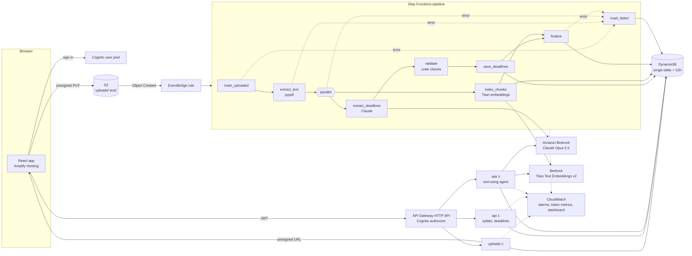

# syllabus-agent

Students upload course outlines as PDFs. The app extracts every deadline, weight, and exam into a database, builds a semester timeline, and answers questions like *"what's due in the next two weeks and how much is it worth?"*, citing the syllabus line each answer came from.

<!-- Record a ~20 s GIF: upload a PDF -> status turns Ready -> Deadlines page -> ask a question. Save as docs/demo.gif -->


**Extraction accuracy:** _run `python eval/run_eval.py` on your labelled syllabi and put the number here_ (see [Evaluation](#evaluation)).

## Architecture



### Upload → deadlines

1. The browser calls `POST /uploads`, gets a presigned URL, and PUTs the PDF **straight to S3**. Files never pass through Lambda or API Gateway, so there are no 6 MB payload limits and no compute spent copying bytes.
2. S3 emits `Object Created` to EventBridge, which starts the state machine. Each stage is its own Lambda:

| Step | What it does | Failure handling |
|---|---|---|
| `mark_uploaded` | Status → `PROCESSING`; rejects objects not registered via `/uploads` | `UnknownUploadError` → failure branch |
| `extract_text` | pypdf → per-page text, stored in S3 (Step Functions payloads cap at 256 KB) | `NoTextError` (scans), `SyllabusTooLargeError`: never silently truncated |
| `extract_deadlines` | Claude reads the outline and calls a `record_course_outline` tool whose JSON schema is the contract | Retried 3× with backoff on throttling or a missing tool call |
| `validate` | Code re-checks every field (below) | |
| `save_deadlines` | Replaces the syllabus's deadline rows (idempotent under retries) | |
| `index_chunks` | Runs **in parallel** with extraction: ~1200-char page-bounded chunks, Titan embeddings | |
| `finalize` | Status → `READY` | |
| `mark_failed` | Catch-all branch: status → `FAILED` with a human-readable reason the UI shows | |

**Prompt design** (`backend/src/extract_deadlines.py`): a strict tool schema (`additionalProperties: false`, enums for type and weekday, nullable date/time/weight), two worked example syllabi showing the edge cases (week numbers, "5 × 4% labs", "final exam scheduled by the Registrar"), and the **term start date passed into the prompt** so "Week 7" can be resolved. The system prompt has an explicit cache breakpoint, so repeated extractions reuse it.

**Validation** (`backend/src/validate.py`): LLM date arithmetic is the classic failure, so `week + weekday + termStart` is recomputed **in code** and wins over the model's date. A week with no weekday becomes that week's Monday, flagged `dateApproximate`. Impossible dates, times and weights are dropped. Dates far outside the term are flagged. Duplicates are removed. A warning appears when the weights don't add up to ~100%. Warnings surface in the UI as "things to double-check".

### Questions → answers (`POST /ask`)

Rather than a separate "is this structured or fuzzy?" classifier, Claude gets four tools and decides itself (an agent):

| Tool | Backed by |
|---|---|
| `get_upcoming_deadlines(days, course?)` | DynamoDB GSI range query `DUE#today … DUE#today+N` |
| `list_deadlines(course?, type?)` | GSI query |
| `search_syllabus(query, course?)` | Titan embedding + cosine top-5 over the user's chunks |
| `list_courses()` | GSI query |

Every record handed to the model gets an id (`D3`, `S2`). The prompt requires each fact to cite one, and the API returns only the sources actually cited, which the UI renders as expandable citations (deadline details, or the quoted passage with its page number).

### Data model (one DynamoDB table)

| pk | sk | gsi1pk | gsi1sk |
|---|---|---|---|
| `SYLLABUS#<id>` | `META` | `USER#<sub>` | `SYLLABUS#<createdAt>` |
| `SYLLABUS#<id>` | `DEADLINE#<nnn>` | `USER#<sub>` | `DUE#<yyyy-mm-dd>#<id>#<nnn>` or `UNDATED#…` |
| `SYLLABUS#<id>` | `CHUNK#<nnnn>` | | |

"What's due between A and B for this user" is a single GSI `BETWEEN` query. Ownership is checked on every read (`ownerId` = Cognito `sub`).

### API

All routes except `/health` require a Cognito ID token (`Authorization: Bearer …`).

| Route | |
|---|---|
| `GET /health` | liveness |
| `POST /uploads` | `{filename, termStart?}` → `{syllabusId, uploadUrl}` |
| `GET /syllabi` · `GET /syllabi/{id}` · `DELETE /syllabi/{id}` | list / status + deadlines / delete everything |
| `GET /deadlines?days=14&today=YYYY-MM-DD` | upcoming (or all without `days`) |
| `POST /ask` | `{question, today?, history?}` → `{answer, citations, toolCalls}` |

## Repo layout

```
backend/src/        one module per Lambda + lib/ (db, llm, vectors, metrics, http)
backend/tests/      unit tests (pure logic, agent loop with a scripted model)
infra/              CDK app: InfraStack (everything) + GithubOidcStack (CI deploy role)
frontend/           React + Vite + Amplify Authenticator
eval/               hand-labelled accuracy evaluation
.github/workflows/  test on every PR, deploy on merge to main
```

## Setup

**Prerequisites:** AWS account, AWS CLI v2, Node 22+, Python 3.12+, CDK CLI (`npm i -g aws-cdk`). In the Bedrock console (us-east-1), enable model access for **Claude Opus 5.5** and **Titan Text Embeddings V2**.

```bash
# 1. backend + infra
cd infra
python -m venv .venv && .venv\Scripts\activate          # macOS/Linux: source .venv/bin/activate
pip install -r requirements.txt -r requirements-dev.txt -r ../backend/requirements-dev.txt
pytest -q && pytest ../backend/tests ../eval -q
cdk bootstrap                                            # once per account/region
cdk deploy SyllabusAgentStack -c alarmEmail=you@example.com
```

No Docker needed: Lambda dependencies are bundled with `pip --platform manylinux2014_x86_64` (see `infra/infra/bundling.py`).

Optional context flags: `-c modelId=anthropic.claude-haiku-5-5` (much cheaper, see [Cost](#cost)), `-c allowedOrigins='["https://main.xxxx.amplifyapp.com"]'` to lock CORS to your domain.

```bash
# 2. frontend (local)
cd frontend
cp .env.example .env.local    # fill in ApiUrl, UserPoolId, UserPoolClientId from the deploy outputs
npm install
npm run dev
```

**3. Hosting (Amplify):** Amplify console → *Create app* → GitHub → this repo, branch `main`. It picks up `amplify.yml`. Add environment variables `AMPLIFY_MONOREPO_APP_ROOT=frontend` plus the three `VITE_*` values. Under *Rewrites and redirects* add `</^[^.]+$|\.(?!(css|gif|ico|jpg|js|png|txt|svg|woff|woff2|ttf|map|json|webp)$)([^.]+$)/>` → `/index.html` (200) so client-side routes work on refresh.

**4. CI/CD (GitHub Actions → `cdk deploy` on every merge):**

```bash
cd infra
cdk deploy SyllabusAgentGithubOidc     # once; prints DeployRoleArn
```

In the GitHub repo settings add secret `AWS_DEPLOY_ROLE_ARN` (that ARN), optionally variable `ALARM_EMAIL`, and create an environment named `production`. The role trusts only `main` of this repo via OIDC (no stored AWS keys) and can only assume the CDK bootstrap roles.

## Evaluation

```bash
python eval/run_eval.py                 # runs the real extract -> validate path on each labelled PDF
python eval/run_eval.py --rescore eval/results/<run>.json   # re-score without calling the model
```

1. Put 5–10 real course outlines in `eval/syllabi/` (git-ignored).
2. For each, copy `eval/labels/example.json`, remove `"example": true`, and list every graded item with its true date and weight.
3. Run it. A deadline counts as **correct** only if it was found *and* its date *and* weight are right. The script also reports recall, precision, date accuracy and weight accuracy, plus per-file misses/extras so you can see what to fix in the prompt.

## Observability

- **Token usage per request:** every Claude call logs `InputTokens`, `OutputTokens` and `CacheReadInputTokens` (plus Titan `EmbeddingTokens`) as CloudWatch Embedded Metric Format, under namespace `SyllabusAgent`, dimension `Operation`.
- **Alarms** on errors for every Lambda and on failed pipeline executions, published to an SNS topic (email via `-c alarmEmail=…`).
- **Dashboard** `syllabus-agent`: tokens per hour and pipeline successes and failures. X-Ray tracing is on for Lambdas and the state machine.

## Cost

Rough estimates at Anthropic list prices (Bedrock prices may differ; check the [Bedrock pricing page](https://aws.amazon.com/bedrock/pricing/)). A typical 10-page outline is about 8k tokens.

| Item | Per unit | Notes |
|---|---|---|
| Extract one syllabus (Opus 5.5) | ~$0.10–0.15 | ~11k input ($4/MTok) + ~3–5k output incl. thinking ($20/MTok) |
| Extract one syllabus (Haiku 5.5) | ~$0.003 | `-c modelId=anthropic.claude-haiku-5-5`; run the eval to see if accuracy holds |
| One `/ask` question (Opus 5.5, low effort) | ~$0.05–0.08 | 2–3 model calls |
| Embeddings (Titan v2) | < $0.001 per syllabus | |
| Lambda, Step Functions, DynamoDB on-demand, S3, API Gateway, Cognito | ≈ $0 at student scale | mostly free tier; ~10 state transitions per upload |
| CloudWatch alarms (13) | ~$1.30 / month | $0.10 per alarm |

A student with 5 courses who asks 50 questions a term costs roughly **$3–5 on Opus 5.5** or **well under $1 on Haiku 5.5**, plus about $1.30/month for alarms.

## Design trade-offs

- **Vector search in DynamoDB, brute force.** One user has a few hundred chunks, so loading them and computing cosine in the Lambda takes milliseconds and costs nothing at rest. OpenSearch Serverless would add a ~$170+/month floor for no visible benefit. If chunk counts grew to tens of thousands per query, I'd move to S3 Vectors or OpenSearch.
- **Agent with tools instead of a hand-written classifier.** Mixed questions ("what's due next week and what's the late penalty?") need both SQL-style and semantic lookups. Letting the model choose avoids a brittle routing step, and the bounded loop (max 6 turns) keeps cost predictable.
- **Tool-call JSON + code validation instead of structured outputs.** The Bedrock Messages endpoint doesn't offer structured outputs, and Opus 5.5 doesn't accept a forced tool choice, so the schema lives on the tool and the `validate` step enforces it. It also recomputes week-based dates deterministically. The model handles reading; code handles arithmetic.
- **Step Functions over one big Lambda.** Per-stage retries (only on the steps that call models), a visible execution graph for debugging, extraction and indexing in parallel, and a single catch-all failure branch that always leaves the UI with an explanation.
- **Opus 5.5 as the default model.** It's the most accurate default for messy real-world outlines. Because the eval gives a single number, swapping in Haiku is a one-flag experiment instead of a guess.
- **`/ask` is request/response.** API Gateway caps integrations at 30 s, which is enough at low effort. Streaming through a Lambda function URL would be the next step for longer answers.
- **Scanned PDFs are rejected with a clear message**, not OCR'd. Textract is the obvious extension.

## Status

- [x] Day 1–2: CDK stack, presigned uploads
- [x] Day 3: EventBridge → Step Functions pipeline, per-stage Lambdas, Claude extraction, validation, retries + failure branch
- [x] Day 4: chunking + Titan embeddings, `/ask` agent with tools and citations
- [x] Day 5: Cognito auth on the API, React app (login, upload, deadlines, chat), Amplify build spec
- [x] Day 6: alarms, per-request token metrics, dashboard, CI/CD with OIDC, evaluation script
- [ ] Day 7: record `docs/demo.gif`, label 5–10 syllabi and publish the accuracy number, have friends try it, add to portfolio
