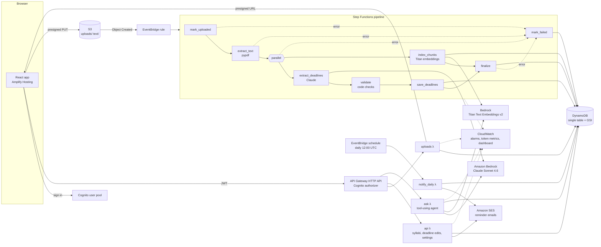

# syllabus-agent

Students upload course outlines as PDFs. The app extracts every deadline, weight, and exam into a database, builds a semester timeline, and answers questions like *"what's due in the next two weeks and how much is it worth?"*, citing the syllabus line each answer came from.

<!-- Record a ~20 s GIF: upload a PDF -> status turns Ready -> Deadlines page -> ask a question. Save as docs/demo.gif -->


**Extraction accuracy: 33/33 deadlines (100%) extracted with the correct date and weight** across 5 real McMaster course outlines, repeated on two independent runs with Claude Sonnet 4.6 (see [Evaluation](#evaluation) for method and caveats).

Students can also **fix or add deadlines by hand**, and turn on **email reminders**: a morning digest of what's due in the next 1–14 days.

## Architecture



### Upload → deadlines

1. The browser calls `POST /uploads`, gets a presigned URL, and PUTs the PDF **straight to S3**. Files never pass through Lambda or API Gateway, so there are no 6 MB payload limits and no compute spent copying bytes.
2. S3 emits `Object Created` to EventBridge, which starts the state machine. Each stage is its own Lambda:

| Step | What it does | Failure handling |
|---|---|---|
| `mark_uploaded` | Status → `PROCESSING`; rejects objects not registered via `/uploads` | `UnknownUploadError` → failure branch |
| `extract_text` | pypdf → per-page text, stored in S3 (Step Functions payloads cap at 256 KB) | `NoTextError` (scans), `SyllabusTooLargeError`: never silently truncated |
| `extract_deadlines` | Claude reads the outline and calls a `record_course_outline` tool whose JSON schema is the contract | Retried 3× with backoff on throttling or a missing tool call |
| `validate` | Code re-checks every field (below) | |
| `save_deadlines` | Replaces the syllabus's deadline rows (idempotent under retries) | |
| `index_chunks` | Runs **in parallel** with extraction: ~1200-char page-bounded chunks, Titan embeddings | |
| `finalize` | Status → `READY` | |
| `mark_failed` | Catch-all branch: status → `FAILED` with a human-readable reason the UI shows | |

**Prompt design** (`backend/src/extract_deadlines.py`): a strict tool schema (`additionalProperties: false`, enums for type and weekday, nullable date/time/weight), two worked example syllabi showing the edge cases (week numbers, "5 × 4% labs", "final exam scheduled by the Registrar"), and the **term start date passed into the prompt** so "Week 7" can be resolved. The system prompt has an explicit cache breakpoint, so repeated extractions reuse it.

**Validation** (`backend/src/validate.py`): LLM date arithmetic is the classic failure, so `week + weekday + termStart` is recomputed **in code** and wins over the model's date. A week with no weekday becomes that week's Monday, flagged `dateApproximate`. Impossible dates, times and weights are dropped. Dates far outside the term are flagged. Duplicates are removed. A warning appears when the weights don't add up to ~100%. Warnings surface in the UI as "things to double-check".

### Questions → answers (`POST /ask`)

Rather than a separate "is this structured or fuzzy?" classifier, Claude gets four tools and decides itself (an agent):

| Tool | Backed by |
|---|---|
| `get_upcoming_deadlines(days, course?)` | DynamoDB GSI range query `DUE#today … DUE#today+N` |
| `list_deadlines(course?, type?)` | GSI query |
| `search_syllabus(query, course?)` | Titan embedding + cosine top-5 over the user's chunks |
| `list_courses()` | GSI query |

Every record handed to the model gets an id (`D3`, `S2`). The prompt requires each fact to cite one, and the API returns only the sources actually cited, which the UI renders as expandable citations (deadline details, or the quoted passage with its page number).

### Editing deadlines

Every deadline has **Edit** and **Delete**, and **+ Add deadline** adds one to any processed course. Hand input goes through the same `validate.py` rules as model output (title required, known type, real date and time, weight 0–100), but bad values are rejected with a message instead of being dropped. An edit keeps the original evidence (the quoted syllabus text and page), and the item is marked *edited* or *added by you*. A week-based "approx." date stays approximate until you actually set the date.

### Email reminders

Turned on per user in **Settings**, with a choice of 1, 3, 7 or 14 days ahead. A daily EventBridge schedule runs `notify_daily`, which emails each opted-in user a digest of what's due in their window and **skips days when nothing is due**. A failure for one address is logged and skipped, so it can't block everyone else. "Today" is computed in `America/Toronto`, not UTC. Only opted-in users are stored in the `NOTIFY` index partition, so the job reads exactly those users and never scans the table.

Mail goes through Amazon SES. New AWS accounts start in the SES **sandbox**, where every recipient must be a verified address, so turning reminders on asks AWS to send the user a one-click verification email first (`SES_SANDBOX=true`, the default). Once you have [SES production access](https://docs.aws.amazon.com/ses/latest/dg/request-production-access.html), deploy with `-c sesSandbox=false`.

### Data model (one DynamoDB table)

| pk | sk | gsi1pk | gsi1sk |
|---|---|---|---|
| `SYLLABUS#<id>` | `META` | `USER#<sub>` | `SYLLABUS#<createdAt>` |
| `SYLLABUS#<id>` | `DEADLINE#<nnn>` | `USER#<sub>` | `DUE#<yyyy-mm-dd>#<id>#<nnn>` or `UNDATED#…` |
| `SYLLABUS#<id>` | `CHUNK#<nnnn>` | | |
| `USER#<sub>` | `SETTINGS` | `NOTIFY` (only while reminders are on) | `USER#<sub>` |

"What's due between A and B for this user" is a single GSI `BETWEEN` query. Ownership is checked on every read and write (`ownerId` = Cognito `sub`).

### API

All routes except `/health` require a Cognito ID token (`Authorization: Bearer …`).

| Route | |
|---|---|
| `GET /health` | liveness |
| `POST /uploads` | `{filename, termStart?}` → `{syllabusId, uploadUrl}` |
| `GET /syllabi` · `GET /syllabi/{id}` · `DELETE /syllabi/{id}` | list / status + deadlines / delete everything |
| `POST /syllabi/{id}/deadlines` | add a deadline `{title, type, dueDate?, dueTime?, weightPercent?}` |
| `PATCH /syllabi/{id}/deadlines/{n}` · `DELETE …/{n}` | edit any of those fields / delete |
| `GET /deadlines?days=14&today=YYYY-MM-DD` | upcoming (or all without `days`) |
| `GET /settings` · `PUT /settings` | reminder settings `{emailEnabled, daysAhead: 1\|3\|7\|14}` |
| `POST /settings/test-email` | send the digest now, even if nothing is due |
| `POST /ask` | `{question, today?, history?}` → `{answer, citations, toolCalls}` |

## Repo layout

```
backend/src/        one module per Lambda + lib/ (db, llm, vectors, notify, metrics, http)
backend/tests/      unit tests (pure logic, agent loop with a scripted model)
infra/              CDK app: InfraStack (everything) + GithubOidcStack (CI deploy role)
frontend/           React + Vite + Amplify Authenticator
eval/               hand-labelled accuracy evaluation
.github/workflows/  test on every PR, deploy on merge to main
```

## Setup

**Prerequisites:** AWS account, AWS CLI v2, Node 22+, Python 3.12+, CDK CLI (`npm i -g aws-cdk`). Bedrock models switch on the first time they're used, but Anthropic models may ask first-time accounts for a short use-case form: in the Bedrock console (us-east-1), open **Model catalog → Claude Sonnet 4.6 → Open in playground** and send one message. Titan Text Embeddings V2 needs no setup.

```bash
# 1. backend + infra
cd infra
python -m venv .venv && .venv\Scripts\activate          # macOS/Linux: source .venv/bin/activate
pip install -r requirements.txt -r requirements-dev.txt -r ../backend/requirements-dev.txt
pytest -q && pytest ../backend/tests ../eval -q
cdk bootstrap                                            # once per account/region
cdk deploy SyllabusAgentStack -c alarmEmail=you@example.com -c notifyFromEmail=you@example.com
```

`notifyFromEmail` turns on email reminders: it's the sender address, and AWS emails it a verification link on the first deploy. Leave it out and the Settings page says reminders aren't set up.

No Docker needed: Lambda dependencies are bundled with `pip --platform manylinux2014_x86_64` (see `infra/infra/bundling.py`).

Optional context flags: `-c modelId=…` to try another model (see [Cost](#cost)). IDs with a region prefix such as `global.anthropic.claude-sonnet-4-6` go through Bedrock `InvokeModel`; bare IDs such as `anthropic.claude-opus-4-8` go through the newer Messages API endpoint. The code and IAM permissions pick the right path from the ID. `-c allowedOrigins='["https://main.xxxx.amplifyapp.com"]'` to lock CORS to your domain.

```bash
# 2. frontend (local)
cd frontend
cp .env.example .env.local    # fill in ApiUrl, UserPoolId, UserPoolClientId from the deploy outputs
npm install
npm run dev
```

**3. Hosting (Amplify):** Amplify console → *Create app* → GitHub → this repo, branch `main`. It picks up `amplify.yml`. Add environment variables `AMPLIFY_MONOREPO_APP_ROOT=frontend` plus the three `VITE_*` values. Under *Rewrites and redirects* add `</^[^.]+$|\.(?!(css|gif|ico|jpg|js|png|txt|svg|woff|woff2|ttf|map|json|webp)$)([^.]+$)/>` → `/index.html` (200) so client-side routes work on refresh.

**4. CI/CD (GitHub Actions → `cdk deploy` on every merge):**

```bash
cd infra
cdk deploy SyllabusAgentGithubOidc     # once; prints DeployRoleArn
```

In the GitHub repo settings add secret `AWS_DEPLOY_ROLE_ARN` (that ARN), and create an environment named `production`. Optional repository variables: `ALARM_EMAIL`, `NOTIFY_FROM_EMAIL` (must match what you deployed with, or a CI deploy removes the reminder setup), and `APP_URL` (your Amplify URL with a trailing `/`, used for the Settings link in reminder emails). The role trusts only `main` of this repo via OIDC (no stored AWS keys) and can only assume the CDK bootstrap roles.

## Evaluation

```bash
python eval/run_eval.py                 # runs the real extract -> validate path on each labelled PDF
python eval/run_eval.py --rescore eval/results/<run>.json   # re-score without calling the model
```

1. Put real course outlines in `syllabus/` (git-ignored; course outlines are copyrighted).
2. For each, copy `eval/labels/example.json`, remove `"example": true`, point `pdf` at the file, and list every graded item with its true date and weight.
3. Run it. A deadline counts as **correct** only if it was found *and* its date *and* weight are right. The script also reports recall, precision, date accuracy and weight accuracy, plus per-file misses and extras so you can see what to fix in the prompt.

### Results (Claude Sonnet 4.6, October 2026)

| Course outline | Graded items | Correct | What makes it hard |
|---|---|---|---|
| COMPSCI 3GC3 Computer Graphics | 7 | 7 | Due dates only appear inside a weekly schedule table |
| COMPSCI 4ML3 Machine Learning | 6 | 6 | "20% (3 assignments)" in one place, the real 5 / 5 / 10 split in another |
| COMPSCI 4ZP6 Capstone (full year) | 7 | 7 | Two-term timeline into April 2027; two deliverables due the same day |
| SFWRENG/COMPSCI 4AL3 Applied ML | 9 | 9 | No dates at all; project milestones weighted as % *of the project* (25/30/45 of 30%) |
| MATH 2UU3 Numbers for Life | 4 | 4 | No dates; schedule lives on Avenue |
| **Total** | **33** | **33 (100%)** | recall 100%, precision 100%, date accuracy 100%, weight accuracy 100% |

The same result held on a second, independent model run (`eval/results/`).

**How the number was reached.** The first run scored 77.4% (24/31). Every miss was checked by hand, and none turned out to be a wrong date or weight:
- **Scorer too strict (fixed):** "A1" wasn't matched to "Assignment 1 (A1)", and "Software Requirement Specification…" wasn't matched to "Unified SRS…". Titles now also match when one title's words all appear in the other, or when the date and non-zero weight are identical. Titles containing different numbers never match ("Assignment 2" ≠ "Assignment 1").
- **Inconsistent labels (fixed):** I had grouped 4AL3's "four assignments, each worth 7%" into one 28% item, but split MATH 2UU3's "two tests, 22% each". The 4AL3 label now lists the assignments separately. I also removed a 0%, ungraded "revise your project description" checkpoint from the 4ZP6 label.

**Caveats.** Five outlines, all from one university, labelled by one person. Treat this as a sanity check that the pipeline works end to end, not as a general accuracy claim. Most of these outlines state their dates explicitly, so the prompt's week-number logic is mainly exercised by the unit tests. The next step is to add outlines that schedule work by week number ("due in Week 7").

## Observability

- **Token usage per request:** every Claude call logs `InputTokens`, `OutputTokens` and `CacheReadInputTokens` (plus Titan `EmbeddingTokens`) as CloudWatch Embedded Metric Format, under namespace `SyllabusAgent`, dimension `Operation`.
- **Alarms** on errors for every Lambda and on failed pipeline executions, published to an SNS topic (email via `-c alarmEmail=…`).
- **Dashboard** `syllabus-agent`: tokens per hour and pipeline successes and failures. X-Ray tracing is on for Lambdas and the state machine.

## Cost

Rough estimates at Anthropic list prices (Bedrock prices may differ; check the [Bedrock pricing page](https://aws.amazon.com/bedrock/pricing/)). A typical 10-page outline is about 8k tokens.

| Item | Per unit | Notes |
|---|---|---|
| Extract one syllabus (Sonnet 4.6) | ~$0.08–0.11 | ~11k input ($3/MTok) + ~3–5k output incl. thinking ($15/MTok) |
| Extract one syllabus (Opus 4.8) | ~$0.13–0.18 | `-c modelId=anthropic.claude-opus-4-8`; run the eval to see whether it's worth it |
| One `/ask` question (Sonnet 4.6, low effort) | ~$0.05–0.06 | 2–3 model calls |
| Embeddings (Titan v2) | < $0.001 per syllabus | |
| Lambda, Step Functions, DynamoDB on-demand, S3, API Gateway, Cognito | ≈ $0 at student scale | mostly free tier; ~10 state transitions per upload |
| Reminder emails (SES) | $0.10 per 1,000 emails | at most one per user per day, and only on days something is due |
| CloudWatch alarms (13, or 14 with reminders) | ~$1.30–1.40 / month | $0.10 per alarm |

A student with 5 courses who asks 50 questions a term costs roughly **$3 on Sonnet 4.6**, plus about $1.40/month for alarms.

## Design trade-offs

- **Vector search in DynamoDB, brute force.** One user has a few hundred chunks, so loading them and computing cosine in the Lambda takes milliseconds and costs nothing at rest. OpenSearch Serverless would add a ~$170+/month floor for no visible benefit. If chunk counts grew to tens of thousands per query, I'd move to S3 Vectors or OpenSearch.
- **Agent with tools instead of a hand-written classifier.** Mixed questions ("what's due next week and what's the late penalty?") need both SQL-style and semantic lookups. Letting the model choose avoids a brittle routing step, and the bounded loop (max 6 turns) keeps cost predictable.
- **Tool-call JSON + code validation instead of structured outputs.** The Bedrock Messages endpoint doesn't offer structured outputs, and the newest models (Opus 5.5, Sonnet 5.5) don't accept a forced tool choice. To keep the model swappable, the schema lives on the tool and the `validate` step enforces it. It also recomputes week-based dates deterministically. The model handles reading; code handles arithmetic.
- **Step Functions over one big Lambda.** Per-stage retries (only on the steps that call models), a visible execution graph for debugging, extraction and indexing in parallel, and a single catch-all failure branch that always leaves the UI with an explanation.
- **Claude Sonnet 4.6 as the default model.** Opus 5.5 is gated per Bedrock account, and Sonnet 4.6 is a strong, mid-priced reader of messy outlines, served through a `global.` cross-region inference profile for availability. The model ID is a single context flag, and because the eval gives a single number, trying another model is an experiment instead of a guess.
- **`/ask` is request/response.** API Gateway caps integrations at 30 s, which is enough at low effort. Streaming through a Lambda function URL would be the next step for longer answers.
- **Scanned PDFs are rejected with a clear message**, not OCR'd. Textract is the obvious extension.
